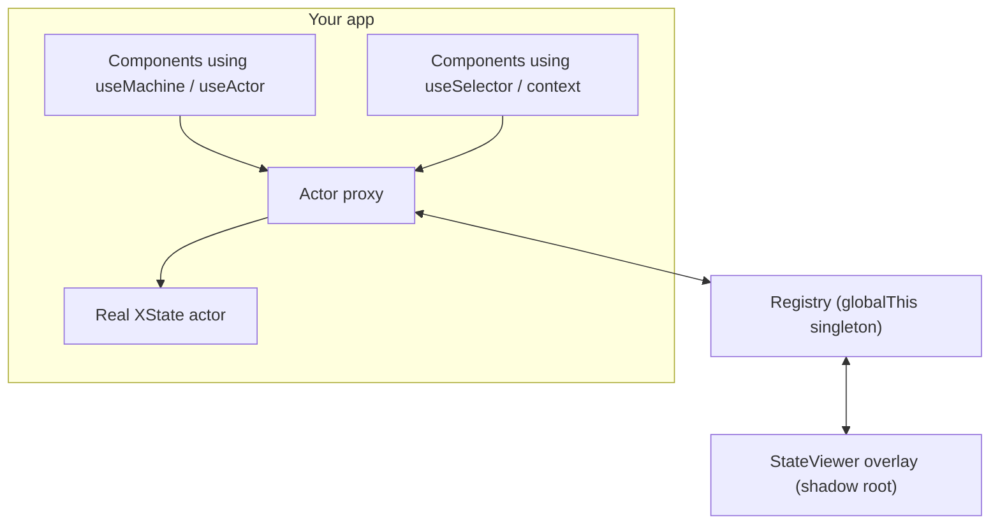
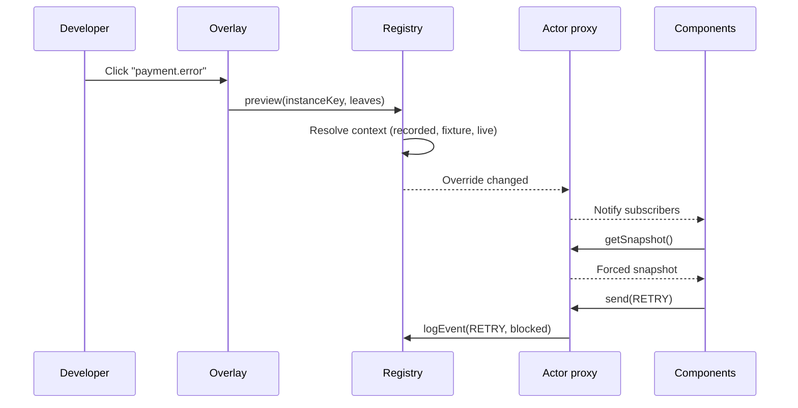

# State debugger: MVP spec and roadmap

- **Name:** `state-viewer` / `<StateViewer />`
- **Status:** Draft 0.1, October 11, 2026
- **MVP scope:** XState v5 + React, development builds only

## 1. Summary

A drop-in React overlay that lists every state of every XState machine on the page, including states the UI has never visited, and lets you preview any of them in place instead of clicking through the flow to reach it.

Integration is two changes. Mount the overlay:

```tsx
import { StateViewer } from 'state-viewer';

function App() {
  return (
    <>
      <YourApp />
      <StateViewer />
    </>
  );
}
```

And swap the import path:

```diff
- import { useMachine, useSelector, createActorContext } from '@xstate/react';
+ import { useMachine, useSelector, createActorContext } from 'state-viewer/xstate';
```

## 2. Problem

Interfaces have many states (loading, empty, error, partial, success), but reaching most of them means recreating the conditions that cause them: throttling the network, forcing an API error, filling a form halfway. Existing tools each cover part of the job:

| Tool | Covers | Missing |
|---|---|---|
| React DevTools | Editing raw hook state in place | No idea which values are valid states |
| TanStack Query Devtools | Forcing loading and error for queries | Server state only |
| Redux DevTools | Jumping between states already visited | No notion of which states are possible |
| Stately Inspector | Visualizing XState actors and events | Built for observing, not forcing |
| Storybook | Rendering every state | Outside the real page, layout and data |

The gap this fills: every state, in context, in the running app.

## 3. Scope

### 3.1 Goals

- **G1** List every machine instance on the page and every state of each machine, including never-visited states.
- **G2** Preview any state in place. Components render the chosen state without remounting, however they read XState state (`useMachine`, `useActor`, `useSelector`, `createActorContext`).
- **G3** Keep previews safe. Events sent during a preview are blocked and logged; the real actor is never modified.
- **G4** Give previews realistic data from recorded snapshots, fixtures or live context, and show which one is in use.
- **G5** Integrate with an import-path swap plus `<StateViewer />`.
- **G6** Leave nothing behind in production builds.
- **G7** Make previews shareable through a URL.

### 3.2 Not in the MVP

| Feature | Planned |
|---|---|
| Moving the real machine into a state ("live mode") | v0.2 |
| Editing context in the panel | v0.2 |
| Element picker (click a component to find its machine) | v0.3 |
| Previewing invoked or spawned child actors (listed read-only in the MVP) | v0.3 |
| `useReducer` and other state libraries | v0.5 |
| Vue, Svelte, Solid | Later |
| XState v6 (currently alpha) | Once stable |
| XState v4 | Not planned |
| Production or staging builds | Open question |

### 3.3 Supported environments

- React 18+ (needs `useSyncExternalStore` and `useId`)
- XState v5 with a compatible `@xstate/react`; the minimum 5.x version gets pinned in Milestone 4
- Evergreen desktop browsers
- Development builds

## 4. Use cases

- **U1 Visual QA:** step through every state of the checkout and compare each one against the design.
- **U2 Bug reproduction:** QA reports a broken layout in `payment.error`; get there in one click.
- **U3 Sharing:** send a designer a link that opens the page in `upload.failed`.
- **U4 Behavior:** in `payment.error`, see what the UI tries to send when Retry is clicked (blocked-event log).
- **U5 Onboarding:** see which states a component actually has.

## 5. Glossary

| Term | Meaning |
|---|---|
| Machine | An XState machine definition, identified by a machine id (`checkout`) |
| Instance | One running actor of a machine; a machine can have many (for example, list rows) |
| Leaf id | Dot path to an atomic or final state, such as `payment.error` |
| Active leaves | The current state expressed as leaf ids, one per parallel region |
| Preview | A view-only override: consumers see a forced snapshot while the real actor keeps running |
| Live jump | Actually moving the real actor into a state (v0.2) |
| Recording | Context captured automatically while the real actor was in a state |
| Fixture | Hand-written context for a state |
| Blocked event | An event the UI sent during a preview; logged, not delivered |

## 6. Requirements

P0 = required for 0.1.0. P1 = in 0.1.0 if time allows.

### 6.1 Discovery

- **R1 (P0)** Actors created through `state-viewer/xstate` hooks register on mount and unregister on unmount.
- **R2 (P0)** Actors created outside React register through `connect(actor, { id })`.
- **R3 (P0)** Each instance gets a stable instance id. Instances group under their machine id and display as `checkout · 1`, `checkout · 2` in registration order.
- **R4 (P0)** The machine id comes from `debug.id`, then `machine.id`. A machine still on XState's default id `'(machine)'` gets a one-time console warning and a generated fallback id.
- **R5 (P1)** Invoked and spawned child machines are discovered through XState's inspection API and listed read-only under their parent.

### 6.2 State listing

- **R6 (P0)** The state tree comes from `machine.root`: compound, parallel, atomic and final nodes. History nodes are excluded.
- **R7 (P0)** The current state is shown as active leaves.
- **R8 (P1)** State `description` and `tags` appear as hints in the tree.

### 6.3 Preview

- **R9 (P0)** Selecting a leaf previews it on the selected instance. In parallel machines, regions you don't touch keep their current leaves.
- **R10 (P0)** Every consumer of the actor sees the preview (hook return values, `useSelector`, context), without remounting.
- **R11 (P0)** The preview is a real XState snapshot: `matches`, `hasTag`, `can` and `status` behave normally.
- **R12 (P0)** Events sent through a previewed actor are not delivered. They're logged with the event, the previewed state and a timestamp.
- **R13 (P0)** The real actor keeps running underneath. Releasing restores the real, current snapshot.
- **R14 (P0)** Release one instance, or all of them.
- **R15 (P1, experimental)** Child actors in `snapshot.children` are carried over from the live snapshot, so components that read them don't break.

### 6.4 Data for previews

- **R16 (P0)** Context resolution order: recorded, then fixture, then live. The panel shows which source was used and lets you switch it per preview.
- **R17 (P0)** The latest context per state configuration is recorded in memory and persisted best-effort to sessionStorage.
- **R18 (P0)** Fixtures are written with `defineFixtures(machine, …)`, keyed by leaf id, and registered through `<StateViewer fixtures>`, which accepts a lazy loader.
- **R19 (P0)** States with neither a recording nor a fixture are marked in the tree. Previewing one falls back to live context with a warning.

### 6.5 Overlay

- **R20 (P0)** `<StateViewer />` renders into a shadow root (a host element appended to `document.body` by default; override with `portalTarget`). Styles don't leak in either direction.
- **R21 (P0)** While any preview is active, the toolbar shows a badge with the count.
- **R22 (P0)** Panel sections: machine list with instance picker, state tree, context viewer, event log.
- **R23 (P0)** Keyboard support as described in §10.6. Shortcuts are ignored while typing.
- **R24 (P0)** Panel open state, position and selected machine persist in localStorage.
- **R25 (P1)** Theme: system, light or dark.
- **R26 (P1)** Copy the current state as JSON, and copy a deep link.

### 6.6 Sharing

- **R27 (P0)** A URL parameter applies previews when the named machines register (§10.4).

### 6.7 Production

- **R28 (P0)** In production builds, `<StateViewer />` renders nothing, `state-viewer/xstate` hooks are plain re-exports of `@xstate/react`, and the registry and overlay are removed from the bundle.

## 7. Architecture



| Layer | Package entry | Responsibility | Imports XState? |
|---|---|---|---|
| Core | `state-viewer` | Protocol types, registry, overrides, recording, fixtures, event log, deep links | No |
| Overlay | `state-viewer` | `<StateViewer />` toolbar and panel; reads the registry with `useSyncExternalStore` | No |
| Adapter | `state-viewer/xstate` | Hooks, actor proxy, `connect`, `defineFixtures`, state-tree extraction | Yes |

Rule: only `state-viewer/xstate` may import `xstate` or `@xstate/react`. Holding that boundary is what makes later adapters additive rather than a rewrite.

### 7.1 Intercept at the actor, not the hook

XState apps rarely read state only from `useMachine`'s return value. They use `useSelector(actorRef, …)`, often through `createActorContext`. In the `@xstate/react` source (XState monorepo, tag `xstate@5.28.0`):

- `useSelector` only calls `subscribe` and `getSnapshot` on the actor.
- `createActorContext`'s Provider creates its actor with `useActorRef` and passes it down through React context.

So every hook in `state-viewer/xstate` builds on one primitive, a proxy around the real actor:

| Member | Normally | While previewing |
|---|---|---|
| `getSnapshot()` | Real snapshot | Forced snapshot from `machine.resolveState(…)`, cached per override |
| `subscribe(observer)` | Real updates | Real updates plus override changes; observers always receive `getSnapshot()` |
| `send(event)` | Delivered | Blocked and logged |
| Everything else | Passed through, bound to the real actor | Same |

Consumers only ever hold the proxy, so live mode (v0.2) can later swap the actor behind it without remounting anything.

### 7.2 Preview flow



## 8. Public API

### 8.1 `state-viewer`

```tsx
import { StateViewer } from 'state-viewer';

<StateViewer
  position="bottom-right"                      // 'top-left' | 'top-right' | 'bottom-left' | 'bottom-right'
  defaultOpen={false}
  theme="system"                               // 'system' | 'light' | 'dark'
  shortcut="alt+s"                             // toggles the panel
  urlParam="debug-state"                       // deep-link query parameter
  fixtures={() => import('./debug/fixtures')}  // FixtureSet[] or a lazy loader
  portalTarget={undefined}                     // Element | ShadowRoot
/>
```

### 8.2 `state-viewer/xstate`

Same names and signatures as `@xstate/react`, plus an optional `debug` option that is stripped before the options reach XState.

```ts
import {
  useMachine,          // [snapshot, send, actorRef]
  useActor,            // [snapshot, send, actorRef]
  useActorRef,         // proxied actor
  useSelector,         // re-export; works on proxies unchanged
  shallowEqual,        // re-export
  createActorContext,  // Provider creates a proxied actor
  connect,             // proxy for actors created outside React
  defineFixtures,
} from 'state-viewer/xstate';

type DebugOptions = {
  id?: string;        // machine id in the registry; defaults to machine.id
  label?: string;     // display name in the panel
  disabled?: boolean; // keep this actor out of the debugger
};

const [snapshot, send] = useMachine(checkoutMachine, { debug: { id: 'checkout' } });

export const appActor = connect(createActor(appMachine).start(), { id: 'app' });
```

### 8.3 Fixtures

```ts
// src/debug/fixtures.ts, loaded lazily by <StateViewer fixtures>
import { defineFixtures } from 'state-viewer/xstate';
import { checkoutMachine } from '../checkout/machine';

const base = { items: [{ id: 'sku_1', qty: 2 }], total: 4800 };

export default [
  defineFixtures(checkoutMachine, {
    'payment.error':   { context: { ...base, error: 'Card declined' } },
    'payment.success': { context: { ...base, receiptId: 'rcpt_123' } },
  }),
];
```

- Keys are leaf ids, typed from the machine's state value type where TypeScript can derive them, otherwise `string`.
- `context` is typed as the machine's context.
- A lazy loader becomes its own chunk that production never loads. Wrap it in a dev check to drop it from the build entirely.

## 9. Core protocol

Adapter-neutral. Nothing here references XState.

```ts
type StateNodeType = 'atomic' | 'compound' | 'parallel' | 'final';

interface StateNodeInfo {
  id: string;            // path from root: "payment.error"
  key: string;           // "error"
  type: StateNodeType;
  description?: string;
  tags?: string[];
  children: StateNodeInfo[];
}

interface Capabilities {
  preview: boolean;
  live: boolean;         // v0.2
  children: boolean;     // can report child machines
}

interface MachineHandle {
  machineId: string;
  instanceId: string;
  label?: string;
  adapter: string;       // "xstate"
  capabilities: Capabilities;
  parentKey?: string;    // set for child machines

  describe(): StateNodeInfo[];
  getActiveLeaves(): string[];
  getContext(): unknown;
  subscribe(onChange: () => void): () => void;   // real state changes
  normalizeTarget(leaves: string[]): string[];   // e.g. fill untouched parallel regions
}

type DataSource = 'recorded' | 'fixture' | 'live';

interface Override {
  instanceKey: string;   // `${machineId}#${instanceId}`
  leaves: string[];
  context: unknown;
  source: DataSource;
  createdAt: number;
}

interface EventLogEntry {
  instanceKey: string;
  event: { type: string; [key: string]: unknown };
  leaves: string[];      // state the UI showed when it sent the event
  blocked: boolean;
  at: number;
}

interface FixtureSet {
  machineId: string;
  states: Record<string, { context: unknown }>;
}

interface RegistrySnapshot {
  machines: MachineHandle[];
  overrides: Record<string, Override>;
  log: EventLogEntry[];
}

interface Registry {
  version: string;
  register(handle: MachineHandle): () => void;
  subscribe(listener: () => void): () => void;
  getSnapshot(): RegistrySnapshot;               // immutable, for useSyncExternalStore

  preview(instanceKey: string, target: { leaves: string[]; source?: DataSource }): void;
  release(instanceKey?: string): void;           // releases all when omitted
  getOverride(instanceKey: string): Override | undefined;
  onOverride(instanceKey: string, listener: () => void): () => void;

  record(instanceKey: string, leaves: string[], context: unknown): void;
  registerFixtures(sets: FixtureSet[]): void;
  logEvent(entry: EventLogEntry): void;
}
```

## 10. Behavior details

### 10.1 Registry

- Created lazily on first use and stored on `globalThis.__STATE_VIEWER_REGISTRY__`, so HMR, multiple React roots and duplicate copies of the package share one instance. The first instance wins; a version mismatch logs a warning.
- `getSnapshot()` returns an immutable snapshot. Change notifications are batched per microtask.
- Per-instance `onOverride` listeners let a proxy react without re-rendering the panel.
- The event log is a ring buffer of 200 entries.

### 10.2 XState adapter

- **State tree:** walk `machine.root.states` recursively, skip `type: 'history'`, and use `node.path.join('.')` as the id.
- **Leaves and state values:** convert `snapshot.value` (a string or nested object) to leaf ids, and leaf ids back into a nested value for `resolveState`.
- **Forced snapshot:** `actor.logic.resolveState({ value, context })`, always passing context (§10.5). Cached by override identity so `getSnapshot()` stays referentially stable for `useSyncExternalStore`.
- **Lifecycle:** instance ids come from `useId()`; registration happens in an effect with cleanup; the proxy is memoized per real actor so StrictMode re-creation works.
- **Child discovery (P1):** the hooks compose their own `inspect` option with any user-provided one. For `connect()`ed actors, find out whether the actor system can take an inspector after creation.
- **`connect()`:** registers immediately and unregisters when the actor stops.

### 10.3 Recording

- On each real snapshot, keep `{ leaves, context }` per configuration key (sorted leaves joined with `|`) as an in-memory reference. XState's `assign` replaces context rather than mutating it, so references stay valid.
- Persist to sessionStorage (`state-viewer:recorded:<machineId>`), debounced, with a replacer that drops functions and actor refs. Entries that fail to serialize stay memory-only. Caps: 50 configurations per machine, 100 KB per entry.
- Lookup: the exact configuration first, then the most recent configuration containing the selected leaf.
- Stay off the hot path: each transition only stores a reference; serialization happens later.

### 10.4 Deep links

- Format: `?debug-state=<machineId>:<leaf>[;<leaf>…][,<machineId>:…]`
  - `?debug-state=checkout:payment.error`
  - `?debug-state=checkout:payment.error;shipping.express,cart:empty`
- `;` separates parallel leaves and `,` separates machines. `+` is avoided because query strings decode it as a space. State keys containing reserved characters are percent-encoded.
- Applied to every instance of the machine as it registers. Context follows the normal resolution order.
- "Copy link" serializes the active previews in the same format.

### 10.5 XState behaviors we design around

Checked in the XState source at tag `xstate@5.28.0`:

- `resolveState` falls back to an empty object when no context is passed, not to the machine's initial context. Always pass context.
- A resolved snapshot starts with no child actors (`children: {}`), so components reading `snapshot.children` get nothing unless R15 carry-over is on.
- A machine without an explicit id gets the id `'(machine)'`.
- When the previewed configuration is final, `snapshot.status` is `'done'`.
- `snapshot.can()` evaluates guards against the previewed context.

### 10.6 Overlay

- **Host:** a `<div data-state-viewer-root>` appended to `document.body`, with an open shadow root, styles injected inside it, a system font stack and `z-index: 2147483647`. Only the toolbar and panel take pointer events.
- **Toolbar:** a 40px bubble, bottom-right by default, carrying the preview badge.
- **Panel:** about 320px wide, at most 70vh tall, scrolling internally.
  - Header: machine selector, instance picker, release all, close
  - State tree (`role="tree"`): active leaves highlighted, previewed leaf marked, data indicator per state (recorded, fixture, none)
  - Context: read-only JSON viewer with a data-source switcher
  - Event log: blocked events with state and time
  - Footer: copy link, copy JSON
- **Shortcuts** (configurable; ignored in inputs, textareas and contenteditable):

| Keys | Where | Action |
|---|---|---|
| `Alt+S` | Anywhere | Toggle the panel |
| `↑` / `↓` | Panel focused | Move through states |
| `Enter` | Panel focused | Preview or release the selected state |
| `Esc` | Panel focused | Release all previews |
| `[` / `]` | Panel focused | Previous / next machine |

- **Accessibility:** everything is keyboard reachable, focus is visible, and `prefers-reduced-motion` is respected.

### 10.7 Production and environments

- Debug code sits behind `process.env.NODE_ENV !== 'production'` so bundlers remove it, and the hooks become re-exports of `@xstate/react`. The package is marked `sideEffects: false`.
- Entry files carry `'use client'`. The registry does nothing on the server.

## 11. Known limitations (MVP)

- Effects inside the machine (invokes, delayed transitions, entry actions) don't run during a preview, by design. Effects in components that react to state, such as a `useEffect` keyed on `snapshot.value`, still do.
- Child actors can't be previewed, and carrying them over is experimental.
- Actors not created through `state-viewer/xstate` or `connect()` are invisible.
- History states can't be selected.
- The real actor keeps running during a preview, so releasing can land the UI somewhere other than where it started.
- Deep links don't carry context.

## 12. Acceptance criteria for 0.1.0

- [ ] In the demo app, swapping the import path and mounting `<StateViewer />` are the only changes needed for every machine to appear.
- [ ] Every non-history state of every demo machine is listed, including never-visited ones.
- [ ] Previewing any state renders without errors using recorded or fixture data.
- [ ] Components reading through `useSelector` and `createActorContext` show the preview.
- [ ] Previews never remount components (checked with mount counters in the demo).
- [ ] Events sent during a preview are blocked and appear in the log.
- [ ] Releasing restores the real, current state.
- [ ] A deep link reproduces a preview after reload.
- [ ] Hostile global CSS doesn't change the panel, and the panel doesn't change the app.
- [ ] The demo's production build contains no registry or overlay code (checked by bundle analysis).
- [ ] Works on React 18 and 19 with StrictMode on.

## 13. Testing strategy

| Level | Tooling | Covers |
|---|---|---|
| Unit | Vitest | Registry, leaf/state-value conversion, deep-link parsing, context resolution, recording caps and serialization |
| Adapter | Vitest + React Testing Library | Proxy with `useMachine`, `useSelector` and `createActorContext`; blocked sends; release; StrictMode double mount; multiple instances; render and mount counts |
| Types | `expectTypeOf` | `defineFixtures` keys and context types |
| End to end | Playwright on the demo app | Previewing every state, deep links, keyboard, the hostile-CSS page |
| Bundle | Production build + size-limit | Debug code removed, size budget |

## 14. Roadmap

### Milestone 0: Setup

- [x] pnpm workspace with `packages/state-viewer` and `apps/demo`
- [x] TypeScript strict; tsdown build with `state-viewer` and `state-viewer/xstate` entries and `'use client'` banners
- [ ] Vitest, React Testing Library, Playwright
- [ ] ESLint, Prettier, CI (typecheck, test, build, size), Changesets
- [ ] Demo app (Vite + React):
  - [ ] Checkout machine with nested and parallel states
  - [ ] A list with one machine per row
  - [ ] A `createActorContext` provider read with `useSelector`
  - [ ] A module-level actor wired with `connect()`
  - [ ] Mount and render counters
- [x] Choose the name and check npm availability (`state-viewer`, unclaimed on npm as of October 13, 2026)

### Milestone 1: Core

- [ ] Protocol types (§9)
- [ ] Registry singleton with version check
- [ ] Overrides and per-instance listeners
- [ ] Batched `subscribe` / `getSnapshot`
- [ ] Event log ring buffer
- [ ] Recording store: memory, sessionStorage, caps, safe serializer
- [ ] Fixture registry and context resolution order
- [ ] Deep-link parsing and serializing
- [ ] Unit tests

### Milestone 2: XState adapter

- [ ] `describe()` from `machine.root`
- [ ] Leaf/state-value conversion and parallel normalization
- [ ] Actor proxy with snapshot caching
- [ ] `useActorRef`, `useActor`, `useMachine`, `createActorContext`; re-export `useSelector` and `shallowEqual`
- [ ] `connect()`
- [ ] Ids: `debug.id`, then `machine.id`, then a fallback with a warning; instance ids from `useId()`
- [ ] Recording hookup
- [ ] `defineFixtures` with typed keys
- [ ] P1: child discovery through a composed `inspect`
- [ ] P1: children carry-over; confirm `matches`, `hasTag` and `can` still work on the copied snapshot
- [ ] Adapter tests

### Milestone 3: Overlay

- [ ] Shadow-root host, portal, style injection, `portalTarget`
- [ ] Toolbar bubble with preview badge
- [ ] Panel: machine list and instance picker, state tree with data indicators, context viewer and source switcher, event log
- [ ] Keyboard shortcuts
- [ ] Persisted panel UI state
- [ ] Deep links applied on registration
- [ ] P1: copy JSON and copy link, theming, description and tag hints
- [ ] Accessibility pass
- [ ] Hostile-CSS test page

### Milestone 4: Hardening and 0.1.0

- [ ] Confirm production removal with Vite, Next.js (webpack and Turbopack), React Router and esbuild
- [ ] Next.js App Router example (`'use client'`, SSR safety)
- [ ] Test matrix: React 18 and 19; pin the minimum XState 5.x
- [ ] Measure overhead with the panel closed
- [ ] README: quickstart, concepts, API, limitations, FAQ
- [ ] Publish 0.1.0

### v0.2: Live mode

- [ ] Swappable actor behind the proxy, restored from a `resolveState` snapshot (on restore, invocations restart and actions don't re-run)
- [ ] Route-based jumps for routable states (XState 5.28+)
- [ ] "Continue from here": turn a preview into a live jump
- [ ] Replay a blocked event after jumping
- [ ] Edit context in the panel

### v0.3: Element picker and instances

- [ ] Pick an element to find its machine (React fiber walk, with a `data-` attribute fallback)
- [ ] Highlight the elements driven by the selected instance
- [ ] Apply a preview to all instances of a machine
- [ ] Preview child actors by proxying the refs in `snapshot.children`

### v0.4: Automation and sharing

- [ ] `window.__STATE_VIEWER__` API: list, preview, release
- [ ] Playwright helper that visits every state and takes a screenshot
- [ ] "Copy repro" as agent-ready markdown: machine, state, context, link
- [ ] Optional encoded context in deep links

### v0.5: Beyond XState

- [ ] `defineReducerMachine`, enforcing four rules:
  1. One discriminant key whose values are the finite states
  2. A fixture for every state
  3. Transitions declared per state and event, compiled into a plain reducer; unhandled events are ignored
  4. Effects declared per state rather than in component `useEffect`s
- [ ] `useMachineReducer`
- [ ] Enforcement: inferred state names and exhaustive fixtures in the types; dev assertions for undeclared states; warnings in the panel
- [ ] Public `state-viewer/core` entry and a custom-adapter guide
- [ ] Investigate a Zag.js adapter

### Later

- [ ] XState v6 adapter once v6 is stable
- [ ] Framework-neutral overlay with Vue, Svelte and Solid adapters
- [ ] ESLint rule for reducers that aren't declared machines
- [ ] Research: a build plugin that extracts union members from TypeScript types
- [ ] Statechart graph view
- [ ] TanStack Devtools plugin build of the panel
- [ ] Opt-in for production-mode staging builds

## 15. Open questions

1. ~~Name and npm package.~~ Resolved: `state-viewer` (see Milestone 0).
2. Default toggle shortcut: `Alt+S`, or a single key like Mesurer's.
3. Data priority: recorded first (realistic, zero authoring) or fixtures first (deterministic)?
4. Deep-link parameter name and format.
5. Should a preview pause the real actor instead of letting it run underneath?
6. ESM-only or dual ESM/CJS?
7. License.
8. Minimum XState 5.x for 0.1.0 (preview only needs `resolveState`; routes need 5.28).
9. Should the MVP log also show real, non-blocked events through inspection?
10. Should `<StateViewer />` be allowed in production-mode builds for staging?

## 16. Decision log

| # | Decision | Reason |
|---|---|---|
| D1 | The MVP supports XState only | Definitions are enumerable; `resolveState` gives real snapshots; inspection reports child actors; routes and restore cover live jumps later |
| D2 | Intercept at the actor with a proxy | `useSelector` only needs `subscribe` and `getSnapshot`; `createActorContext` passes the actor through context; v6 renames hooks but keeps the actor interface |
| D3 | Preview before live | A view-level override can't be knocked out by the app, and the real actor is never touched |
| D4 | Neutral protocol: leaf ids, opaque context, capabilities | New state libraries become adapters, not rewrites |
| D5 | Opt-in integration by import swap; no fiber access in the MVP | Reliable and typed; fiber tooling like bippy has to load before React |
| D6 | Overlay in a shadow root | Style isolation in both directions |
| D7 | Development builds only | No production cost |
| D8 | `useReducer` later, through declared machines | Union types are erased at runtime, so states must be declared to be listed |

## 17. References

- Inspiration: [Agentation](https://github.com/benjitaylor/agentation), [Mesurer](https://github.com/ibelick/mesurer), [DialKit](https://github.com/joshpuckett/dialkit)
- XState docs: [Persistence and `resolveState`](https://stately.ai/docs/persistence), [Routes](https://stately.ai/docs/routes), [Inspection API](https://stately.ai/docs/inspection), [v5 to v6 migration](https://stately.ai/docs/xstate/v6/xstate-v5-to-v6)
- XState source at `xstate@5.28.0`: [useSelector](https://github.com/statelyai/xstate/blob/xstate%405.28.0/packages/xstate-react/src/useSelector.ts), [createActorContext](https://github.com/statelyai/xstate/blob/xstate%405.28.0/packages/xstate-react/src/createActorContext.ts), [StateMachine](https://github.com/statelyai/xstate/blob/xstate%405.28.0/packages/core/src/StateMachine.ts)
- Prior art: [TanStack Query "Trigger Loading" PR](https://github.com/TanStack/query/pull/6010), [bippy](https://bippy.million.dev), [TanStack Devtools custom plugins](https://tanstack.com/devtools/latest/docs/building-custom-plugins)
