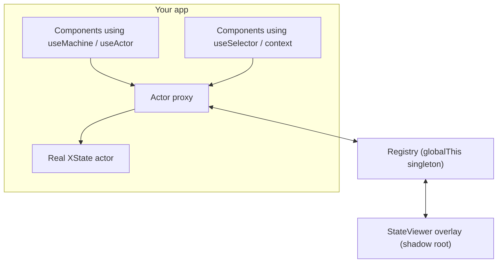
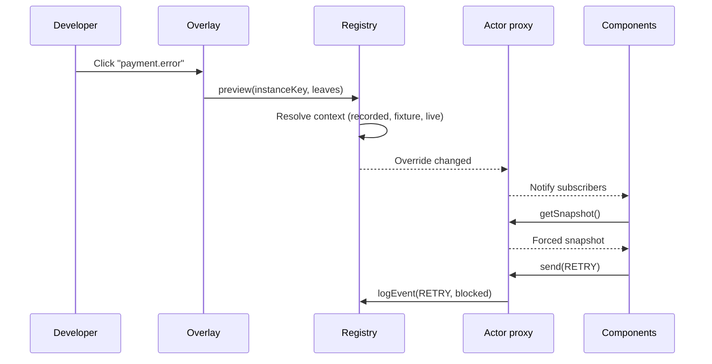

# State debugger: MVP spec and roadmap

- **Name:** `state-viewer` / `<StateViewer />`
- **Status:** Draft 0.1, October 11, 2026
- **MVP scope:** XState v5 + React, development builds only

## 1. Summary

A drop-in React overlay that lists every state of every XState machine on the page, including states the UI has never visited, and lets you preview any of them in place instead of clicking through the flow to reach it.

Integration is two changes. Mount the overlay:

```tsx
import { StateViewer } from 'state-viewer';

function App() {
  return (
    <>
      <YourApp />
      <StateViewer />
    </>
  );
}
```

And swap the import path:

```diff
- import { useMachine, useSelector, createActorContext } from '@xstate/react';
+ import { useMachine, useSelector, createActorContext } from 'state-viewer/xstate';
```

## 2. Problem

Interfaces have many states (loading, empty, error, partial, success), but reaching most of them means recreating the conditions that cause them: throttling the network, forcing an API error, filling a form halfway. Existing tools each cover part of the job:

| Tool | Covers | Missing |
|---|---|---|
| React DevTools | Editing raw hook state in place | No idea which values are valid states |
| TanStack Query Devtools | Forcing loading and error for queries | Server state only |
| Redux DevTools | Jumping between states already visited | No notion of which states are possible |
| Stately Inspector | Visualizing XState actors and events | Built for observing, not forcing |
| Storybook | Rendering every state | Outside the real page, layout and data |

The gap this fills: every state, in context, in the running app.

## 3. Scope

### 3.1 Goals

- **G1** List every machine instance on the page and every state of each machine, including never-visited states.
- **G2** Preview any state in place. Components render the chosen state without remounting, however they read XState state (`useMachine`, `useActor`, `useSelector`, `createActorContext`).
- **G3** Keep previews safe. Events sent during a preview are blocked and logged; the real actor is never modified.
- **G4** Give previews realistic data from recorded snapshots, fixtures or live context, and show which one is in use.
- **G5** Integrate with an import-path swap plus `<StateViewer />`.
- **G6** Leave nothing behind in production builds.
- **G7** Make previews shareable through a URL.

### 3.2 Not in the MVP

| Feature | Planned |
|---|---|
| Moving the real machine into a state ("live mode") | v0.2 |
| Editing context in the panel | v0.2 |
| Element picker (click a component to find its machine) | v0.3 |
| Previewing invoked or spawned child actors (listed read-only in the MVP) | v0.3 |
| `useReducer` and other state libraries | v0.5 |
| Vue, Svelte, Solid | Later |
| XState v6 (currently alpha) | Once stable |
| XState v4 | Not planned |
| Production or staging builds | Open question |

### 3.3 Supported environments

- React 18+ (needs `useSyncExternalStore`)
- XState 5.28+ with `@xstate/react` 6.1+ (pinned in Milestone 4, D23)
- Evergreen desktop browsers
- Development builds

## 4. Use cases

- **U1 Visual QA:** step through every state of the checkout and compare each one against the design.
- **U2 Bug reproduction:** QA reports a broken layout in `payment.error`; get there in one click.
- **U3 Sharing:** send a designer a link that opens the page in `upload.failed`.
- **U4 Behavior:** in `payment.error`, see what the UI tries to send when Retry is clicked (blocked-event log).
- **U5 Onboarding:** see which states a component actually has.

## 5. Glossary

| Term | Meaning |
|---|---|
| Machine | An XState machine definition, identified by a machine id (`checkout`) |
| Instance | One running actor of a machine; a machine can have many (for example, list rows) |
| Leaf id | Dot path to an atomic or final state, such as `payment.error` |
| Active leaves | The current state expressed as leaf ids, one per parallel region |
| Preview | A view-only override: consumers see a forced snapshot while the real actor keeps running |
| Live jump | Actually moving the real actor into a state (v0.2) |
| Recording | Context captured automatically while the real actor was in a state |
| Fixture | Hand-written context for a state |
| Blocked event | An event the UI sent during a preview; logged, not delivered |

## 6. Requirements

P0 = required for 0.1.0. P1 = in 0.1.0 if time allows.

### 6.1 Discovery

- **R1 (P0)** Actors created through `state-viewer/xstate` hooks register on mount and unregister on unmount.
- **R2 (P0)** Actors created outside React register through `connect(actor, { id })`.
- **R3 (P0)** Each instance gets a stable instance id. Instances group under their machine id and display as `checkout · 1`, `checkout · 2` in registration order.
- **R4 (P0)** The machine id comes from `debug.id`, then `machine.id`. A machine still on XState's default id `'(machine)'` gets a one-time console warning and a generated fallback id.
- **R5 (P1)** Invoked and spawned child machines are discovered through XState's inspection API and listed read-only under their parent.

### 6.2 State listing

- **R6 (P0)** The state tree comes from `machine.root`: compound, parallel, atomic and final nodes. History nodes are excluded.
- **R7 (P0)** The current state is shown as active leaves.
- **R8 (P1)** State `description` and `tags` appear as hints in the tree.

### 6.3 Preview

- **R9 (P0)** Selecting a leaf previews it on the selected instance. In parallel machines, regions you don't touch keep their current leaves.
- **R10 (P0)** Every consumer of the actor sees the preview (hook return values, `useSelector`, context), without remounting.
- **R11 (P0)** The preview is a real XState snapshot: `matches`, `hasTag`, `can` and `status` behave normally.
- **R12 (P0)** Events sent through a previewed actor are not delivered. They're logged with the event, the previewed state and a timestamp.
- **R13 (P0)** The real actor keeps running underneath. Releasing restores the real, current snapshot.
- **R14 (P0)** Release one instance, or all of them.
- **R15 (P1, experimental)** Child actors in `snapshot.children` are carried over from the live snapshot, so components that read them don't break.

### 6.4 Data for previews

- **R16 (P0)** Context resolution order: recorded, then fixture, then live. The panel shows which source was used and lets you switch it per preview. Previews that used the default order are resolved again when fixtures register, so a preview made before a lazy loader finishes picks up its fixture.
- **R17 (P0)** The latest context per state configuration is recorded in memory and persisted best-effort to sessionStorage.
- **R18 (P0)** Fixtures are written with `defineFixtures(machine, …)`, keyed by leaf id, and registered through `<StateViewer fixtures>`, which accepts a lazy loader. A fixture set matches instances of the same machine definition first (its config, which `machine.provide()` copies share), then of the same machine id, so `debug.id` and generated ids need no extra setup.
- **R19 (P0)** States with neither a recording nor a fixture are marked in the tree. Previewing one falls back to live context with a warning. While a fixtures loader is pending, a preview on the default order waits to warn until the loader settles, and warns only if no fixture then gives it context (§10.3).

### 6.5 Overlay

- **R20 (P0)** `<StateViewer />` renders into a shadow root (a host element appended to `document.body` by default; override with `portalTarget`). Styles don't leak in either direction.
- **R21 (P0)** While any preview is active, the toolbar shows a badge with the count.
- **R22 (P0)** Panel sections: machine list with instance picker, state tree, context viewer, event log.
- **R23 (P0)** Keyboard support as described in §10.6. Shortcuts are ignored while typing.
- **R24 (P0)** Panel open state, position and selected machine persist in localStorage.
- **R25 (P1)** Theme: system, light or dark.
- **R26 (P1)** Copy the current state as JSON, and copy a deep link.

### 6.6 Sharing

- **R27 (P0)** A URL parameter applies previews when the named machines register (§10.4).

### 6.7 Production

- **R28 (P0)** In production builds, `<StateViewer />` renders nothing, `state-viewer/xstate` hooks are plain re-exports of `@xstate/react`, and the registry and overlay are removed from the bundle.

## 7. Architecture



| Layer | Package entry | Responsibility | Imports XState? |
|---|---|---|---|
| Core | `state-viewer` | Protocol types, registry, overrides, recording, fixtures, event log, deep links | No |
| Overlay | `state-viewer` | `<StateViewer />` toolbar and panel; reads the registry with `useSyncExternalStore` | No |
| Adapter | `state-viewer/xstate` | Hooks, actor proxy, `connect`, `defineFixtures`, state-tree extraction | Yes |

Rule: only `state-viewer/xstate` may import `xstate` or `@xstate/react`. Holding that boundary is what makes later adapters additive rather than a rewrite.

### 7.1 Intercept at the actor, not the hook

XState apps rarely read state only from `useMachine`'s return value. They use `useSelector(actorRef, …)`, often through `createActorContext`. In the `@xstate/react` source (XState monorepo, tag `xstate@5.28.0`):

- `useSelector` only calls `subscribe` and `getSnapshot` on the actor.
- `createActorContext`'s Provider creates its actor with `useActorRef` and passes it down through React context.

So every hook in `state-viewer/xstate` builds on one primitive, a proxy around the real actor:

| Member | Normally | While previewing |
|---|---|---|
| `getSnapshot()` | Real snapshot | Forced snapshot from `machine.resolveState(…)`, cached per override |
| `subscribe(observer)` | Real updates | Real updates plus override changes; observers always receive `getSnapshot()` |
| `send(event)`, `_send(event)` | Delivered | Blocked and logged |
| `select`, `Symbol.observable` | The real actor's | Follow the preview, through `getSnapshot` and `subscribe` |
| `start()`, `stop()` | Called on the real actor; return the proxy | Same |
| Everything else | Passed through, bound to the real actor | Same |

Consumers only ever hold the proxy, so live mode (v0.2) can later swap the actor behind it without remounting anything.

### 7.2 Preview flow



## 8. Public API

### 8.1 `state-viewer`

```tsx
import { StateViewer } from 'state-viewer';

<StateViewer
  position="bottom-right"                      // 'top-left' | 'top-right' | 'bottom-left' | 'bottom-right'
  defaultOpen={false}
  theme="system"                               // 'system' | 'light' | 'dark'
  shortcut="alt+s"                             // toggles the panel
  urlParam="debug-state"                       // deep-link query parameter
  fixtures={() => import('./debug/fixtures')}  // FixtureSet[] or a lazy loader
  portalTarget={undefined}                     // Element | ShadowRoot
/>
```

### 8.2 `state-viewer/xstate`

Same names and signatures as `@xstate/react`, plus an optional `debug` option that is stripped before the options reach XState.

```ts
import {
  useMachine,          // [snapshot, send, actorRef]
  useActor,            // [snapshot, send, actorRef]
  useActorRef,         // proxied actor
  useSelector,         // re-export; works on proxies unchanged
  shallowEqual,        // re-export
  createActorContext,  // Provider creates a proxied actor
  connect,             // proxy for actors created outside React
  defineFixtures,
} from 'state-viewer/xstate';

type DebugOptions = {
  id?: string;        // machine id in the registry; defaults to machine.id
  label?: string;     // display name in the panel
  disabled?: boolean; // keep this actor out of the debugger
};

const [snapshot, send] = useMachine(checkoutMachine, { debug: { id: 'checkout' } });

export const appActor = connect(createActor(appMachine).start(), { id: 'app' });
```

### 8.3 Fixtures

```ts
// src/debug/fixtures.ts, loaded lazily by <StateViewer fixtures>
import { defineFixtures } from 'state-viewer/xstate';
import { checkoutMachine } from '../checkout/machine';

const base = { items: [{ id: 'sku_1', qty: 2 }], total: 4800 };

export default [
  defineFixtures(checkoutMachine, {
    'payment.error':   { context: { ...base, error: 'Card declined' } },
    'payment.success': { context: { ...base, receiptId: 'rcpt_123' } },
  }),
];
```

- Keys are leaf ids, typed from the machine's state value type where TypeScript can derive them, otherwise `string`.
- `context` is typed as the machine's context.
- In a parallel preview, the first leaf with a fixture wins: the requested leaves in order, then the leaves filled in for untouched regions (§10.3).
- A lazy loader becomes its own chunk that production never loads. Wrap it in a dev check to drop it from the build entirely.

## 9. Core protocol

Adapter-neutral. Nothing here references XState.

```ts
type StateNodeType = 'atomic' | 'compound' | 'parallel' | 'final';

interface StateNodeInfo {
  id: string;            // path from root: "payment.error"
  key: string;           // "error"
  type: StateNodeType;
  description?: string;
  tags?: string[];
  children: StateNodeInfo[];
}

interface Capabilities {
  preview: boolean;
  live: boolean;         // v0.2
  children: boolean;     // can report child machines
}

interface MachineHandle {
  machineId: string;
  instanceId: string;
  label?: string;
  adapter: string;       // "xstate"
  capabilities: Capabilities;
  parentKey?: string;    // set for child machines
  source?: unknown;      // definition object (the XState machine's config); matched against FixtureSet.source

  describe(): StateNodeInfo[];
  getActiveLeaves(): string[];
  getContext(): unknown;
  subscribe(onChange: () => void): () => void;   // real state changes
  normalizeTarget(leaves: string[]): string[];   // e.g. fill untouched parallel regions
}

type DataSource = 'recorded' | 'fixture' | 'live';

interface Override {
  instanceKey: string;   // `${machineId}#${instanceId}`
  requested: string[];   // leaves asked for, in order
  leaves: string[];      // full configuration: requested first, then filled-in regions
  context: unknown;
  source: DataSource;
  createdAt: number;
}

interface EventLogEntry {
  instanceKey: string;
  event: { type: string; [key: string]: unknown };
  leaves: string[];      // state the UI showed when it sent the event
  blocked: boolean;
  at: number;
}

interface FixtureSet {
  machineId: string;
  source?: unknown;      // definition object from defineFixtures; matched before machineId
  states: Record<string, { context: unknown }>;
}

interface DataAvailability {
  recorded: ReadonlySet<string>;  // leaf ids contained in at least one recording
  fixture: ReadonlySet<string>;   // leaf ids with a fixture
}

interface RegistrySnapshot {
  machines: MachineHandle[];
  overrides: Record<string, Override>;
  log: EventLogEntry[];                     // oldest first
  data: Record<string, DataAvailability>;   // by machineId
}

interface Registry {
  version: string;
  register(handle: MachineHandle): () => void;
  subscribe(listener: () => void): () => void;
  getSnapshot(): RegistrySnapshot;               // immutable, for useSyncExternalStore

  preview(instanceKey: string, target: { leaves: string[]; source?: DataSource }): void;
  release(instanceKey?: string): void;           // releases all when omitted
  getOverride(instanceKey: string): Override | undefined;
  onOverride(instanceKey: string, listener: () => void): () => void;

  record(instanceKey: string, leaves: string[], context: unknown): void;
  registerFixtures(sets: FixtureSet[]): void;
  expectFixtures(): () => void;                  // a fixture load starts; call the result when it ends (§10.3)
  logEvent(entry: EventLogEntry): void;
  clearLog(): void;
}
```

## 10. Behavior details

### 10.1 Registry

- Created lazily on first use and stored on `globalThis.__STATE_VIEWER_REGISTRY__`, so HMR, multiple React roots and duplicate copies of the package share one instance. The first instance wins; a version mismatch logs a warning.
- `getSnapshot()` returns an immutable snapshot. Change notifications are batched per microtask.
- Per-instance `onOverride` listeners let a proxy react without re-rendering the panel.
- The event log is a ring buffer of 200 entries, oldest first in the snapshot. `clearLog()` empties it.
- `data` is rebuilt only when a leaf's markers change: a configuration recorded for the first time, an eviction, a sessionStorage load, or fixtures registering. Recording a configuration that's already known doesn't touch the snapshot.
- Unregistering removes the instance from the snapshot at once but keeps its preview until the next flush. A cleanup followed by a setup in the same tick (Fast Refresh, StrictMode) therefore keeps the preview and the instance's position. If a different handle takes over the key and the preview names a leaf its tree doesn't have, or leaves it can't have active together (`normalizeTarget` drops one: a parallel state edited into a compound one), the preview is released, so the app isn't left blocking events under a preview it can't show. When `normalizeTarget` adds leaves for regions the edit added, the preview stays and its configuration names them, so blocked events are logged with what the app shows and fixtures are looked up against them.

### 10.2 XState adapter

- **State tree:** walk `machine.root.states` recursively, skip `type: 'history'`, and use `node.path.join('.')` as the id.
- **Leaves and state values:** convert `snapshot.value` (a string or nested object) to leaf ids, and leaf ids back into a nested value for `resolveState`.
- **Forced snapshot:** `actor.logic.resolveState({ value, context })`, always passing context (§10.5). Cached by override identity so `getSnapshot()` stays referentially stable for `useSyncExternalStore`.
- **Lifecycle:** instance ids come from a page-wide counter on `globalThis`, taken once per component in `useState`. `useId()` isn't enough: separately hydrated roots each start from the same ids, so two islands rendering one machine would share a key. Registration and the preview listener are set up in a layout effect, before @xstate/react starts the actor in its passive effect, so the registry records the configuration the component first rendered and everything `start()` goes through, as with `connect(createActor(m)).start()`. They're torn down in a passive cleanup, where @xstate/react stops the actor, so a Suspense boundary hiding the component (which runs only layout cleanups, while the actor keeps running) keeps it registered and previewed. There's one proxy per real actor, whatever `debug` options the hook gets, so StrictMode re-creation works and a label change doesn't re-render context consumers. The proxy listens to the registry only while one of its registrations is connected, or while the registry still keeps a preview for it (until its next flush after the unregister): nothing can preview an actor nobody registers, and subscribers that never unsubscribe, on a finished actor or made after the component unmounted, don't keep it alive. When `debug.disabled` turns on, the observer given to the hook leaves the preview as on a release, also when it turns on while an Activity hides the component (on the reveal). Which actor and binding the hook's observer follows is decided in the commit phase, so a render React throws away (a suspended transition that would replace the actor or turn `debug.disabled` on) doesn't move it. A preview applied as the actor registers (a deep link) shows in the first paint, whatever the priority of the commit that mounts the component: the observer hears it in the layout phase, and `useMachine`/`useActor` re-render from a layout effect when the snapshot changed since their render, since `useSyncExternalStore` checks only in a passive effect, after the paint.
- **Proxy:** it overrides `getSnapshot`, `subscribe`, `send`, `_send` (what `sendTo`, `forwardTo` and delayed sends call on their target), `select`, `start`, `stop` and `Symbol.observable`. Everything else goes to the real actor. During a preview, `send` and `_send` are blocked and logged, and an event that isn't an object with a string `type` is dropped with a warning. A previewed final state has status `'done'` and the output the machine's `output` mapper gives for it.
- **Observers and the actor's ending:** observers see what the proxy shows, and hear how the real actor ended (complete or error) once no preview hides the real snapshot (R13). When the actor finishes, fails or stops during a preview, observers keep following previews, and when the preview ends they get the done snapshot, then `complete` (or `error`), so `waitFor` resolves rather than seeing the actor end without its final snapshot. A consumer that only re-renders (`useSelector`, the hooks' store) is also woken to leave the preview when the actor stopped, including one that subscribed after the stop, which XState tells nothing. An observer without `next`, such as `toPromise`'s, isn't told about previews at all and hears at once; the proxy shows the real snapshot while an observer hears how the actor ended, so `toPromise` resolves with the real output. Unsubscribing, even from inside `next`, ends all of it. What an observer's callback throws is reported from a timer, as XState reports it, and doesn't keep the observer from hearing the rest. After that:
  - `proxy.subscribe()` observers stop once their own `complete` or `error` has been called, or once the actor is stopped. `useSelector`'s observer has no `complete`, so it keeps receiving previews of a finished machine; a failure reaches its error callback, and it throws it as @xstate/react does. When @xstate/react stops a hook's actor (unmount, StrictMode's simulated unmount, a hidden Activity, Fast Refresh), it drops the actor's observers without telling them and puts the last active snapshot back; the hook ends the subscriptions made through the proxy along with them, so a pending `waitFor` hears no previews of an actor nothing serves any more, and doesn't keep it alive. One still owed how the actor ended, which a preview held back, hears it when the preview ends, as the registry drops the unregistered instance's preview at its next flush, and ends then.
  - The hooks' own store keeps receiving previews until the actor is stopped, whatever it was told before.
  - An observer passed to `useActorRef` gets no previews once the actor is done, fails or stops, as with @xstate/react. It still hears what XState sends it, which is the ending again when @xstate/react restarts a finished actor (an Activity revealed). One first passed after the actor ended hears only what XState sends it then, `complete` or the error, at once, and none of the finished actor's previews. That holds for an inline observer too, a new one on every render: what the component's observers were told, and an ending a preview holds back, are kept per hook and real actor, whatever `debug.disabled` says, so a re-render during a preview of the finished actor doesn't hand the new one the previews or the done snapshot again, and a re-render before the release doesn't lose the ending. An ending whose preview ended while the hook wasn't listening (an Activity hid the component) reaches it when the hook connects again. When @xstate/react replaces the actor (a new config: Fast Refresh of the machine's module, a machine built from props), an ending a preview held back for the old one is still owed: the observer hears it once the hook's actor is no longer previewed (at once when the new actor registers under another id), before anything about the new actor, whose real snapshot it hears from XState when @xstate/react starts it. A stable observer, which @xstate/react subscribes again only when its effects run again (StrictMode, an Activity revealed), stays with the replaced actor and gets none of the new one's previews until then; if a preview of the replaced actor was the last thing it saw, it hears that actor's real snapshot when the preview ends. Until @xstate/react moves an observer (in the passive effects of the commit that replaced the actor, for an inline one), what the replaced actor sends it is about the replaced actor: an update or ending it makes while a preview of the hook's actor shows is held back and owed like the others, and hearing it end doesn't stop the observer hearing the new actor's previews. When one render both replaces the actor and turns `debug.disabled` on, leaving the preview is decided for the observer of that render. What the observer was told moves to the new actor in the commit that replaces it, `debug.disabled` or not, and what XState tells it directly about the replaced actor isn't repeated later. Only `complete` repeats, which XState calls on every observer @xstate/react subscribes to a finished actor.
- **Child discovery (P1):** the actor system takes an inspector after creation (`actor.system.inspect`), so hooks and `connect()` work the same way and the `inspect` option is left to the app. When an actor registers, children that already exist are found through `snapshot.children`; later ones arrive as `@xstate.snapshot` inspection events. A child is listed only under a listed parent, so `connect()` on a child doesn't list the rest of the system, and the children XState leaves running when their parent fails don't come back as orphans. A child leaves the list when it reports a status other than `active`, or when it fails, which XState reports only as an `xstate.error.actor.*` event to its parent. Its descendants go with it, and each one's last snapshot is recorded first, so a final configuration is kept even when a grandchild's finish ends its parent, or ends a `connect()`ed root, before the grandchild's own snapshot comes in. Children are listed by `${machineId}#${sessionId}` with the invoke or spawn id as the label.
- **`connect()`:** registers immediately, with an instance id from the same counter as the hooks, and unregisters when the actor's inspected snapshot reports a status other than `active` (done or stopped), or when the proxy's `stop()` is called before the actor started. Connecting the same actor again returns the same proxy, and so does connecting an actor a hook created (found through `system.get()`, say): it stays registered under the hook's id and label, with a warning if `connect()` was given others. Passing the hook's proxy works the same way. An actor that fails stays listed: XState emits no snapshot for the failure, and an observer with an error callback would stop XState from reporting the error as unhandled.
- **Fixture matching:** the handle's `source` is `machine.config`, and `defineFixtures` stores the same object on its `FixtureSet`. The config rather than the machine, because `machine.provide()` returns a new machine that shares it, so a component that injects implementations still gets its fixtures. The generated fallback id (R4) must stay the same when HMR recreates the machine, because fixtures follow the registry id once the config changes (§10.3). It's a hash of the state tree's shape (keys and node types, sorted by key) and of the sorted keys of `config.context` when that's a plain object. It stays the same unless states are added, removed, renamed or change type, or context keys come and go, so reordering states doesn't change it, and the context keys tell apart anonymous machines with the same states, such as two fetch machines.

### 10.3 Recording and fixtures

- On each real snapshot, keep `{ leaves, context }` per configuration key (sorted leaves joined with `|`) as an in-memory reference. XState's `assign` replaces context rather than mutating it, so references stay valid.
- Persist to sessionStorage (`state-viewer:recorded:<machineId>`), debounced, with a replacer that drops functions. A context that can't be restored faithfully stays memory-only: one holding an actor ref, a value JSON changes (`Date`, `Map`, `Set`, class instances, non-finite numbers), a shared or circular reference, or anything that fails to serialize.
- Caps: 50 configurations per machine, 100 KB per entry, and 1,000,000 UTF-16 code units across every machine's key, so recordings never crowd out the app's own sessionStorage. Over a cap, the oldest recordings are left out of storage but stay in memory.
- Lookup: the exact configuration first, then the most recent configuration containing the selected leaf.
- Stay off the hot path: each transition only stores a reference; serialization happens later.
- A leaf is marked recorded when at least one recorded configuration contains it, matching the lookup fallback.
- Fixture sets match an instance by `source` (the same definition object), then by `machineId`. The id fallback covers HMR, which recreates the machine and its config. A set that matched by source keeps matching that registry id afterwards, so machines under `debug.id` or a generated id keep their fixtures across HMR. Sets for the same machine merge, and a later set wins per leaf id.
- When fixtures register, every preview whose source came from the default order is checked again for the same configuration, and replaced only if its context or source changed. A live preview picks up a fixture that now matches, a fixture preview follows its fixture (or falls back to live if none matches any more), and a preview on a recording stays put. Recordings aren't consulted again, so a preview never changes with live traffic. Previews with an explicitly chosen source are left alone.
- `<StateViewer fixtures>` calls `expectFixtures()` when a load starts, and the function it returns when the load settles: after its sets register, or when the loader fails. It starts the load in an insertion effect, like the deep link, so the registry expects the fixtures before the app's hooks register in layout effects and the link previews them. While any load is pending, a preview on the default order that finds only live context holds its R19 warning (D25). When the last pending load ends, the preview warns if it still uses the live context; one released or previewed again in the meantime doesn't, and the instances of one linked machine warn once. A preview with an explicitly chosen source warns at once, since fixtures registering leave it alone. A loader that never settles keeps the warning back.
- Fixture lookup checks the requested leaves in the order given (the clicked leaf, or a deep link's order), then the leaves `normalizeTarget` filled in. The first leaf with a fixture wins.

### 10.4 Deep links

- Format: `?debug-state=<machineId>:<leaf>[;<leaf>…][,<machineId>:…]`
  - `?debug-state=checkout:payment.error`
  - `?debug-state=checkout:payment.error;shipping.express,cart:empty`
- `;` separates parallel leaves and `,` separates machines. `+` is avoided because query strings decode it as a space. State keys containing reserved characters are percent-encoded.
- Applied to every instance of the machine as it registers. Context follows the normal resolution order.
- Links target machines, not instances. "Copy link" writes one preview per machine: the selected instance's if it's previewed, otherwise the first-registered previewed instance's. It writes the override's `requested` leaves, so after a reload the untouched regions follow each instance's own state (R9) and context resolves as it did originally. When other instances of that machine have different requested leaves, the panel says the link won't reproduce them.

### 10.5 XState behaviors we design around

Checked in the XState source at tag `xstate@5.28.0`:

- `resolveState` falls back to an empty object when no context is passed, not to the machine's initial context. Always pass context.
- A resolved snapshot starts with no child actors (`children: {}`), so components reading `snapshot.children` get nothing unless R15 carry-over is on.
- A machine without an explicit id gets the id `'(machine)'`.
- When the previewed configuration is final, `snapshot.status` is `'done'`.
- `snapshot.can()` evaluates guards against the previewed context.

### 10.6 Overlay

- **Host:** a `<div data-state-viewer-root>` appended to `document.body`, with an open shadow root, styles injected inside it, a system font stack and `z-index: 2147483647`. Only the toolbar and panel take pointer events.
- **Toolbar:** a 40px bubble, bottom-right by default, carrying the preview badge.
- **Panel:** about 320px wide, at most 70vh tall, scrolling internally.
  - Header: machine selector, instance picker, release all, move to the next corner, close
  - State tree (`role="tree"`): active leaves highlighted, previewed leaf marked, data indicator per state (recorded, fixture, none)
  - Context: read-only JSON viewer with a data-source switcher
  - Event log: blocked events with state and time, and a clear button
  - Footer: copy link, copy JSON
- **Selecting a leaf** (click or `Enter`) adds it to the instance's preview, first, so its fixture is looked up first; `normalizeTarget` drops the previewed leaves it can't be active with, and leaves in other parallel regions stay. Selecting a previewed leaf takes it out, and taking out the last one releases the instance. Child machines are listed read-only.
- **Focus:** opening the panel by hand (bubble or shortcut) moves focus to the tree; closing gives it back to where the shortcut was pressed, or to the bubble. A panel left open across a reload doesn't take focus.
- **Shortcuts** (configurable; ignored in inputs, textareas and contenteditable):

| Keys | Where | Action |
|---|---|---|
| `Alt+S` | Anywhere | Toggle the panel |
| `↑` / `↓` | Panel focused | Move through states |
| `Home` / `End` | Panel focused | First / last state |
| `Enter` | Panel focused | Preview or release the selected state |
| `Esc` | Panel focused | Release all previews |
| `[` / `]` | Panel focused | Previous / next machine |

- Panel keys stay with the controls that use them: arrows in the selects and the source switcher, `Enter` on buttons.
- **Accessibility:** everything is keyboard reachable, focus is visible, and `prefers-reduced-motion` is respected.

### 10.7 Production and environments

- Debug code sits behind `process.env.NODE_ENV !== 'production'` so bundlers remove it: `<StateViewer />` becomes a component that renders nothing, and the hooks become re-exports of `@xstate/react`. The package is marked `sideEffects: false`.
- The condition is written out at each use (D21). esbuild, webpack and Turbopack don't copy the value of a `const DEV = …` into its uses, so they'd keep both branches.
- Module-level values in debug-only modules are free of side effects as minifiers see them: calls such as `Object.freeze` carry `/* @__PURE__ */`, and the overlay's style sheet comes from a function, since minifiers keep a top-level template literal with `${…}` parts.
- tsdown builds each entry on its own, so the core is in both output files and no chunk is shared (D22). Turbopack keeps a chunk that a module imports, even when only code it removes used it. Two copies are safe because the registry lives on `globalThis` (§10.1).
- Each entry's source starts with `'use client'`, which the build keeps at the top of its output. The registry does nothing on the server.
- `pnpm check:bundles` confirms all of this against the packed tarball (D20): it builds a fixture app that uses every export with esbuild, Vite, Next.js (webpack and Turbopack) and React Router, then the examples, and looks for strings that only debug code contains. With esbuild and Vite, the startup JavaScript is about 150–160 B (gzip) larger than the same app on `@xstate/react`; the check fails above 512 B.

## 11. Known limitations (MVP)

- Effects inside the machine (invokes, delayed transitions, entry actions) don't run during a preview, by design. Effects in components that react to state, such as a `useEffect` keyed on `snapshot.value`, still do.
- Child actors can't be previewed, and carrying them over is experimental.
- Actors not created through `state-viewer/xstate` or `connect()` are invisible.
- History states can't be selected.
- The real actor keeps running during a preview, so releasing can land the UI somewhere other than where it started.
- Deep links don't carry context.
- Deep links target machines, not instances: every instance of a linked machine gets the same preview.
- A router that parses and rebuilds the query string breaks deep links whose machine id contains `:`, whose leaf id contains `;`, or whose ids contain `,` or `%`.
- Functions in context are dropped when a recording is persisted, so after a reload they're missing from a recorded preview.
- Fixture markers in the tree follow the first-registered instance of a machine id. Another instance whose machine config differs (for example after HMR) can resolve different fixtures.
- A machine without an id gets a generated id from its state tree's shape and context keys, so editing its states or context keys during HMR changes the id, and its previews and id-matched fixtures don't carry over.
- A `connect()`ed actor that fails stays listed until the page reloads.
- In the state tree, arrow keys move through leaves only; compound and parallel states aren't focusable.
- A page that gives `body` a transform, filter or `contain` becomes the containing block of the overlay's fixed host, which then moves with it. Pass `portalTarget={document.documentElement}` on such pages.
- A `connect()`ed actor that's stopped before it ever started, through the actor itself rather than its proxy, stays listed until the page reloads: XState reports nothing in that case.
- Observers passed to the hooks match @xstate/react exactly when nothing is previewed. Around a preview, a few narrow sequences deliver a snapshot once more, once less or later than ideal; the totals of `complete` and `error` still match @xstate/react:
  - An inline observer hears the new actor's preview once when @xstate/react replaces the actor (a new config: Fast Refresh, a machine built from props).
  - Endings owed across such a replacement arrive in the order the actors ended.
  - A stable observer revealed by an Activity after a preview was released while it was hidden hears one extra real snapshot.
  - After an Activity reveal, an ending a preview held back is delivered by the hook and again by each @xstate/react restart.
  - An observer passed in the short window between a preview change in the layout phase and @xstate/react's subscribe may hear a preview of an actor that already ended.
  - `useSelector` consumers may render one frame of the real state before a deep-link preview.
- A preview snapshot is rebuilt, and observers hear it again, when the live children it carries over change or when the preview is updated (fixtures loading, an HMR edit adding a region).

## 12. Acceptance criteria for 0.1.0

Checked by the end-to-end suite (state-viewer-e2e), `pnpm check:bundles` and `pnpm test:matrix`.

- [x] In the vite-react example, swapping the import path and mounting `<StateViewer />` are the only changes needed for every machine to appear. The module-level session actor also goes through `connect()` (R2).
- [x] Every non-history state of every example machine is listed, including never-visited ones.
- [x] Previewing any state renders without errors using recorded or fixture data.
- [x] Components reading through `useSelector` and `createActorContext` show the preview.
- [x] Previews never remount components (checked with mount counters in the vite-react example).
- [x] Events sent during a preview are blocked and appear in the log.
- [x] Releasing restores the real, current state.
- [x] A deep link reproduces a preview after reload.
- [x] Hostile global CSS doesn't change the panel, and the panel doesn't change the app (checked in the hostile-css example).
- [x] The examples' production builds contain no registry or overlay code (checked by bundle analysis).
- [x] Works on React 18 and 19 with StrictMode on.

## 13. Testing strategy

| Level | Tooling | Covers |
|---|---|---|
| Unit | Vitest | Registry, leaf/state-value conversion, deep-link parsing, context resolution, recording caps and serialization |
| Adapter | Vitest + React Testing Library | Proxy with `useMachine`, `useSelector` and `createActorContext`; blocked sends; release; StrictMode double mount; multiple instances; render and mount counts |
| Types | `expectTypeOf` | `defineFixtures` keys and context types |
| Version matrix | `pnpm test:matrix` (`scripts/test-matrix.mjs`) | The Vitest suite on React 18 and 19, each with the minimum and the latest `xstate` and `@xstate/react` (D24) |
| End to end | Playwright, in a separate repository (state-viewer-e2e), against the examples' dev servers | Previewing every state, deep links, keyboard, navigation between pages, the hostile-css example, server rendering and hydration in the Next.js example |
| Bundle | `pnpm check:bundles` (`tests/bundles/check.mjs`), against the packed tarball | Debug code removed with each supported bundler; startup JavaScript against the same app on `@xstate/react`, with a 512 B gzip budget |
| Overhead | `pnpm --filter state-viewer bench` (`bench/overhead.bench.tsx`) | Development cost with the panel closed and without `<StateViewer />`, against `@xstate/react` |

## 14. Roadmap

### Milestone 0: Setup

- [x] pnpm workspace with `packages/state-viewer` and `examples/*`
- [x] TypeScript strict; tsdown build with `state-viewer` and `state-viewer/xstate` entries, each starting with `'use client'`
- [x] Vitest and React Testing Library
- [ ] ESLint, Prettier, CI (typecheck, test, build, size), Changesets
- [x] Example app (Vite + React Router, `examples/vite-react`), with one page per example and a home page that lists them:
  - [x] Checkout machine with nested and parallel states
  - [x] A list with one machine per row
  - [x] A `createActorContext` provider read with `useSelector`
  - [x] A module-level actor wired with `connect()`
  - [x] Mount and render counters
- [x] Choose the name and check npm availability (`state-viewer`, unclaimed on npm as of October 13, 2026)

### Milestone 1: Core

- [x] Protocol types (§9)
- [x] Registry singleton with version check
- [x] Overrides and per-instance listeners
- [x] Batched `subscribe` / `getSnapshot`
- [x] Event log ring buffer
- [x] Recording store: memory, sessionStorage, caps, safe serializer
- [x] Fixture registry and context resolution order
- [x] Data availability per leaf in the snapshot
- [x] Deep-link parsing and serializing
- [x] Unit tests

### Milestone 2: XState adapter

- [x] `describe()` from `machine.root`
- [x] Leaf/state-value conversion and parallel normalization
- [x] Actor proxy with snapshot caching
- [x] `useActorRef`, `useActor`, `useMachine`, `createActorContext`; re-export `useSelector` and `shallowEqual`
- [x] `connect()`
- [x] Ids: `debug.id`, then `machine.id`, then a fallback with a warning; instance ids from a page-wide counter
- [x] Recording hookup
- [x] `defineFixtures` with typed keys, carrying the machine's config as `source`
- [x] P1: child discovery through the system inspector
- [x] P1: children carry-over; confirm `matches`, `hasTag` and `can` still work on the copied snapshot
- [x] Adapter tests

### Milestone 3: Overlay

- [x] Shadow-root host, portal, style injection, `portalTarget`
- [x] Toolbar bubble with preview badge
- [x] Panel: machine list and instance picker, state tree with data indicators, context viewer and source switcher, event log
- [x] Keyboard shortcuts
- [x] Persisted panel UI state
- [x] Deep links applied on registration
- [x] P1: copy JSON and copy link, theming, description and tag hints
- [x] Accessibility pass
- [x] Hostile-CSS example (`examples/hostile-css`)

### Milestone 4: Hardening and 0.1.0

- [x] Confirm production removal with Vite, Next.js (webpack and Turbopack), React Router and esbuild (`pnpm check:bundles`, §10.7)
- [x] Next.js App Router example (`'use client'`, SSR safety): `examples/next-app`, on port 3100
- [x] End-to-end tests with Playwright in a separate repository, run against the examples (state-viewer-e2e)
- [x] Test matrix: React 18 and 19; pin the minimum XState 5.x (`pnpm test:matrix`; `xstate` 5.28, `@xstate/react` 6.1)
- [x] Measure overhead with the panel closed. In jsdom with StrictMode, against `@xstate/react`: about 8 µs more per transition that re-renders a `useMachine` component (27 → 34 µs), 22 µs more per mount (50 rows: 1.0 → 2.1 ms), and under 1 µs more per event to a `connect()`ed actor. Mounting `<StateViewer />` with its panel closed adds nothing measurable; the cost is the adapter's.
- [x] README: quickstart, concepts, API, limitations, FAQ
- [ ] Publish 0.1.0

### v0.2: Live mode

- [ ] Swappable actor behind the proxy, restored from a `resolveState` snapshot (on restore, invocations restart and actions don't re-run)
- [ ] Route-based jumps for routable states (XState 5.28+)
- [ ] "Continue from here": turn a preview into a live jump
- [ ] Replay a blocked event after jumping
- [ ] Edit context in the panel

### v0.3: Element picker and instances

- [ ] Pick an element to find its machine (React fiber walk, with a `data-` attribute fallback)
- [ ] Highlight the elements driven by the selected instance
- [ ] Apply a preview to all instances of a machine
- [ ] Preview child actors by proxying the refs in `snapshot.children`

### v0.4: Automation and sharing

- [ ] `window.__STATE_VIEWER__` API: list, preview, release
- [ ] Playwright helper that visits every state and takes a screenshot
- [ ] "Copy repro" as agent-ready markdown: machine, state, context, link
- [ ] Optional encoded context in deep links

### v0.5: Beyond XState

- [ ] `defineReducerMachine`, enforcing four rules:
  1. One discriminant key whose values are the finite states
  2. A fixture for every state
  3. Transitions declared per state and event, compiled into a plain reducer; unhandled events are ignored
  4. Effects declared per state rather than in component `useEffect`s
- [ ] `useMachineReducer`
- [ ] Enforcement: inferred state names and exhaustive fixtures in the types; dev assertions for undeclared states; warnings in the panel
- [ ] Public `state-viewer/core` entry and a custom-adapter guide
- [ ] Investigate a Zag.js adapter

### Later

- [ ] XState v6 adapter once v6 is stable
- [ ] Framework-neutral overlay with Vue, Svelte and Solid adapters
- [ ] ESLint rule for reducers that aren't declared machines
- [ ] Research: a build plugin that extracts union members from TypeScript types
- [ ] Statechart graph view
- [ ] TanStack Devtools plugin build of the panel
- [ ] Opt-in for production-mode staging builds

## 15. Open questions

1. ~~Name and npm package.~~ Resolved: `state-viewer` (see Milestone 0).
2. Default toggle shortcut: `Alt+S`, or a single key like Mesurer's.
3. Data priority: recorded first (realistic, zero authoring) or fixtures first (deterministic)?
4. Deep-link parameter name and format.
5. Should a preview pause the real actor instead of letting it run underneath?
6. ESM-only or dual ESM/CJS?
7. License.
8. ~~Minimum XState 5.x for 0.1.0.~~ Resolved: `xstate` 5.28 and `@xstate/react` 6.1 (D23).
9. Should the MVP log also show real, non-blocked events through inspection?
10. Should `<StateViewer />` be allowed in production-mode builds for staging?

## 16. Decision log

| # | Decision | Reason |
|---|---|---|
| D1 | The MVP supports XState only | Definitions are enumerable; `resolveState` gives real snapshots; inspection reports child actors; routes and restore cover live jumps later |
| D2 | Intercept at the actor with a proxy | `useSelector` only needs `subscribe` and `getSnapshot`; `createActorContext` passes the actor through context; v6 renames hooks but keeps the actor interface |
| D3 | Preview before live | A view-level override can't be knocked out by the app, and the real actor is never touched |
| D4 | Neutral protocol: leaf ids, opaque context, capabilities | New state libraries become adapters, not rewrites |
| D5 | Opt-in integration by import swap; no fiber access in the MVP | Reliable and typed; fiber tooling like bippy has to load before React |
| D6 | Overlay in a shadow root | Style isolation in both directions |
| D7 | Development builds only | No production cost |
| D8 | `useReducer` later, through declared machines | Union types are erased at runtime, so states must be declared to be listed |
| D9 | Data availability lives in the registry snapshot | The panel reads everything through one `useSyncExternalStore` source, and the snapshot changes only when a marker flips |
| D10 | Fixtures match by machine config, then by id | Works with `debug.id`, generated ids and `machine.provide()` copies without extra options; the id fallback survives HMR |
| D11 | Parallel previews use the first fixture found, requested leaves before filled-in ones | Mirrors the recording fallback and keeps `defineFixtures` keys to single leaf ids |
| D12 | Deep links stay machine-level | Registration order isn't stable across reloads, so instance ordinals could open the wrong row; instance targeting can come with v0.3 |
| D13 | Previews on the default order are resolved again when fixtures register | Lazy fixtures load after deep links apply on page load; a preview shouldn't stay on live context |
| D14 | Contexts holding actor refs stay memory-only | A restored context missing its refs crashes the components that read them; falling back to a fixture or live context is safer |
| D15 | Fixture sets remember the registry ids they matched by source | Keeps fixtures for `debug.id` and generated ids across HMR without a protocol change |
| D16 | Overrides keep the requested leaves | Copy link, source switching and the previewed-leaf mark need what was asked for, not the filled-in configuration |
| D17 | A total budget for persisted recordings | The debugger must never make the app's own sessionStorage writes fail |
| D18 | Unregistering keeps the preview until the next flush | Fast Refresh re-runs effects on every save, and a preview should survive editing the component it previews |
| D19 | Examples stay minimal; end-to-end tests live in a separate repository | The examples read as usage documentation, without test ids, extra pages or Playwright setup |
| D20 | Production removal is checked against the packed tarball, with each bundler | The examples use the workspace source; only the tarball shows what users get (`dist`, `publishConfig.exports`, `sideEffects`) |
| D21 | The `NODE_ENV` condition is written out at each use | esbuild, webpack and Turbopack don't inline a `const`, so a shared `DEV` constant keeps both branches in production |
| D22 | Each entry is built on its own, without shared chunks | Turbopack keeps a shared chunk once a module imports it, even if only removed code used it; the `globalThis` registry makes the duplicated core safe |
| D23 | Minimum versions: `xstate` 5.28, `@xstate/react` 6.1 | @xstate/react 6.1 forwards actor errors to error boundaries, which the adapter matches, and needs `xstate` ^5.28. The suite passes on both minimums and on the latest versions; below 5.29, only the @xstate/react controls that call the real `Actor.select` are skipped |
| D24 | On React 18, tests built on `<Activity>` or `use()` are skipped, and identity checks record committed renders only | React 18 has neither API, and its StrictMode throws away the first render together with the actor it created, which the @xstate/react controls show too |
| D25 | A preview on the default order holds its live-context warning while fixtures load | A deep link applies before a lazy loader is done, and the fixtures that load then give most such previews context (D13), so an early warning would usually be false |

## 17. References

- Inspiration: [Agentation](https://github.com/benjitaylor/agentation), [Mesurer](https://github.com/ibelick/mesurer), [DialKit](https://github.com/joshpuckett/dialkit)
- XState docs: [Persistence and `resolveState`](https://stately.ai/docs/persistence), [Routes](https://stately.ai/docs/routes), [Inspection API](https://stately.ai/docs/inspection), [v5 to v6 migration](https://stately.ai/docs/xstate/v6/xstate-v5-to-v6)
- XState source at `xstate@5.28.0`: [useSelector](https://github.com/statelyai/xstate/blob/xstate%405.28.0/packages/xstate-react/src/useSelector.ts), [createActorContext](https://github.com/statelyai/xstate/blob/xstate%405.28.0/packages/xstate-react/src/createActorContext.ts), [StateMachine](https://github.com/statelyai/xstate/blob/xstate%405.28.0/packages/core/src/StateMachine.ts)
- Prior art: [TanStack Query "Trigger Loading" PR](https://github.com/TanStack/query/pull/6010), [bippy](https://bippy.million.dev), [TanStack Devtools custom plugins](https://tanstack.com/devtools/latest/docs/building-custom-plugins)
